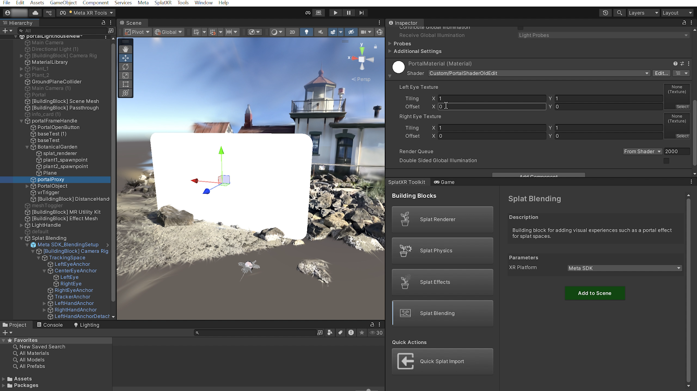

# Splat Blending

System for creating portal effects where splat spaces can be viewed through virtual windows, blending reality with the splat spaces.

## Purpose

Use this building block to create portal effects where users can look through a virtual window into a different splat space.

## Examples

<figure>
<video autoplay muted loop playsinline aria-label="Blending portal: a botanical garden splat seen through a window in a real wall">
<source src="../videos/blending_garden_portal.mp4" type="video/mp4">
</video>
<figcaption><strong>Garden portal</strong>: a botanical garden splat seen through a window in a real wall.</figcaption>
</figure>
<figure>
<video autoplay muted loop playsinline aria-label="Blending portal: a living room splat blending into the real room through soft portal edges">
<source src="../videos/blending_room_portal.mp4" type="video/mp4">
</video>
<figcaption><strong>Room portal</strong>: a living room splat blends into the real space through soft portal edges.</figcaption>
</figure>

## Parameters

| Parameter | Description |
| --- | --- |
| XR Platform | Choose **Meta SDK** or **Other**. Blending on platforms other than Meta SDK is untested. On Apple Vision Pro, only fully immersive (Metal) apps are expected to work. |
| Center Eye Camera | The headset's center eye camera. You can assign the camera itself (`CenterEyeAnchor` for Meta SDK), the Meta camera rig (e.g. the [Building Block] Camera Rig), or any parent of a camera tagged `MainCamera`. |

## Usage

The block:

1. Adds a `SplatBlendingPortal` object to the scene, with a sample portal plane that uses the Blending Portal material.
2. Adds `LeftEyeBlending` and `RightEyeBlending` cameras under the center eye camera.
3. Creates a `"BlendingWorld"` layer if it doesn't exist. The left and right eye cameras render only that layer, and the center eye camera stops rendering it.

Objects on the `"BlendingWorld"` layer are only visible through the portal. Put everything you want seen through the portal, such as a splat space, on that layer. To make your own portal window, apply the Blending Portal material to any mesh. This also works on volumes such as 3D objects, not just flat planes: apply the material to a cube or sphere, for example, to see the splat space through the object's surface.

Adding the block again with the same center eye camera reuses the existing portal and eye cameras instead of creating duplicates. There is a controllable **Edge Softness** parameter in the material shader to create a vignette effect along the border of the portal window.
