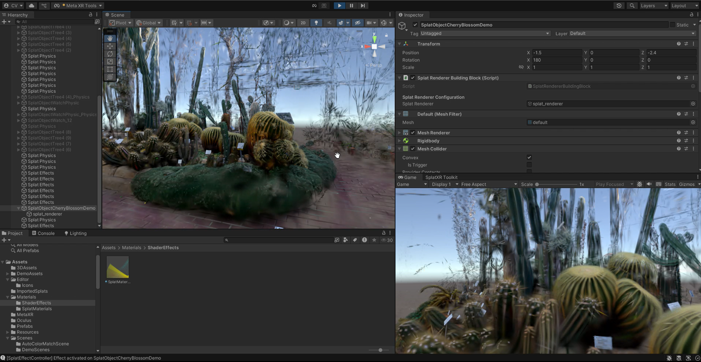

# Splat Effects

Visual effects system for applying shader-based effects to Gaussian splats, including disintegration, radial reveal, and digital rain.

## Purpose

Add this building block to the parent splat GameObject to create dynamic visual effects. Useful for transitions, interactions, or stylized appearances.

## Examples

<figure>
<video autoplay muted loop playsinline aria-label="Disintegrate effect: a potted plant assembles from particles on a table, then disintegrates">
<source src="../videos/effects_disintegrate.mp4" type="video/mp4">
</video>
<figcaption><strong>Disintegrate</strong>: a plant assembles from particles, then breaks apart.</figcaption>
</figure>
<figure>
<video autoplay muted loop playsinline aria-label="Digital Rain effect: green splats rain down and assemble into a room">
<source src="../videos/effects_digital_rain.mp4" type="video/mp4">
</video>
<figcaption><strong>Digital Rain</strong>: splats rain down and assemble, inspired by the falling code in <em>The Matrix</em>.</figcaption>
</figure>

## Parameters

| Parameter | Description |
| --- | --- |
| Target Splat | The parent splat GameObject created by the Splat Renderer building block (the one with the `splat_renderer` child). |
| Effect Selection | **Disintegrate**: particle-based disintegration effect. **Radial Reveal**: spherical reveal/hide effect from a point. **Digital Rain**: splats rain down and assemble into the object. **Custom Shader**: use your own effect shader. |
| Custom Shader | *(Custom Shader only)* The shader to apply. Required when Custom Shader is selected. |

## Usage

The block swaps the shader on the `splat_renderer` child's material for the effect shader, and adds a `SplatEffectsBuildingBlock` component to the parent object.

!!! note "Turn on the effect"
    **Is Effect Active** is off by default, so the effect won't play until you check it. Select the splat's parent object and check **Is Effect Active** on the `SplatEffectsBuildingBlock` component in the Inspector.

Each effect runs across a timeline from `0` to `1`. Control it from the `SplatEffectsBuildingBlock` component in the Inspector:

| Field | Description |
| --- | --- |
| Is Effect Active | Turn on to play the effect, off to stop it. Off by default. |
| Time Multiplier | Playback speed. At `1`, the effect takes 1 second from start to end. |
| Loop Effect | Restart from `0` after reaching `1`. Otherwise the effect holds at `1`. |

From a script, call `StartEffect()`, `StopEffect()`, `SetTime(float)` (clamped to `0`–`1`), and `SetLoop(bool)`.

### Writing a custom effect shader

Each frame the component sets two material properties, which your shader should declare:

- `_EffectActive`: `1` while the effect is playing, otherwise `0`.
- `_EffectTime`: the current position on the `0`–`1` timeline.

The easiest way to start is the template generator in the Splat Effects panel:

1. Expand **Create Custom Shader Effect** in the Splat Effects building block.
2. Enter a **Shader Name** for your effect.
3. Click **Create Custom Shader Effect**.

This creates a template shader at `Assets/Materials/SplatShaders/SplatEffect_<name>.shader` and selects it as the **Custom Shader**. The template already includes the splat rendering code and the `_EffectActive` and `_EffectTime` properties. Edit the sections marked `YOUR EFFECT GOES HERE` to add your effect, then click **Add to Splat**.

You can also start from one of the built-in shaders in `Runtime/SplatXRBuildingBlocks/Effects/Shaders`, so your shader keeps the splat rendering code.
