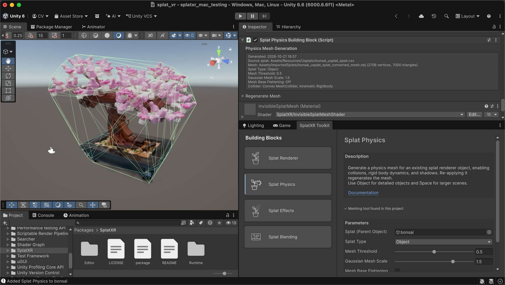

# Splat Physics

Generates collision meshes from Gaussian splats to enable physics interactions, rigid body dynamics, and shadow casting.

!!! warning "Requires the meshing tool"
    This building block needs the SplatXR meshing tool. It's included in the release zip. If you installed from the GitHub source instead, see [Installation](../installation.md#meshing-tool) to download it.

    **macOS:** the first time the tool runs, macOS may block it because it's from an unidentified developer. Go to **System Settings > Privacy & Security**, scroll to the message about `splatxr_meshing_mac`, and click **Open Anyway**. Then run the Splat Physics block again.

## Purpose

Apply this building block to an existing splat renderer object when you need collision detection, physics collisions, or shadow casting.

## Parameters

| Parameter | Description |
| --- | --- |
| Target Splat | Existing splat GameObject created by the Splat Renderer building block. You can select the parent object or its `splat_renderer` child; physics is always added to the parent. |
| Splat Type | **Object** (detailed mesh for props/items) or **Space** (simplified mesh for rooms/environments). |
| Mesh Threshold | *(Object type)* Density threshold for mesh generation. Range 0–1, default `0.5`. |
| Gaussian Mesh Scale | *(Object type)* Scale factor for individual gaussians during meshing. Larger values help for sparser gaussians. Range 0–2, default `1.5`. |
| Mesh Base Flattening | *(Object type)* Enable to flatten the bottom of the mesh (useful for placing objects on surfaces). |
| Flatten Percentage | *(If flattening enabled)* Percentage of the mesh to flatten from the base. Must be greater than 0 and less than 100, default `5`. |
| Flatten Axis | *(If flattening enabled)* Axis direction for flattening, generally the base (`X`, `Y`, `Z`, `-X`, `-Y`, `-Z`). |

## Usage

**Object** meshing creates more detailed meshes suitable for interactive props, while **Space** meshing creates simplified meshes for environment boundaries.

The physics mesh, collider, and Rigidbody go on the splat's parent object, not on the `splat_renderer` child that draws it.
!!! warning "Known limitation"
    Scene-based meshing (Splat Type: Space) may not produce highly detailed meshes. For objects requiring detailed collision meshes, use Splat Type: Object instead. See the [FAQ](../faq.md).
